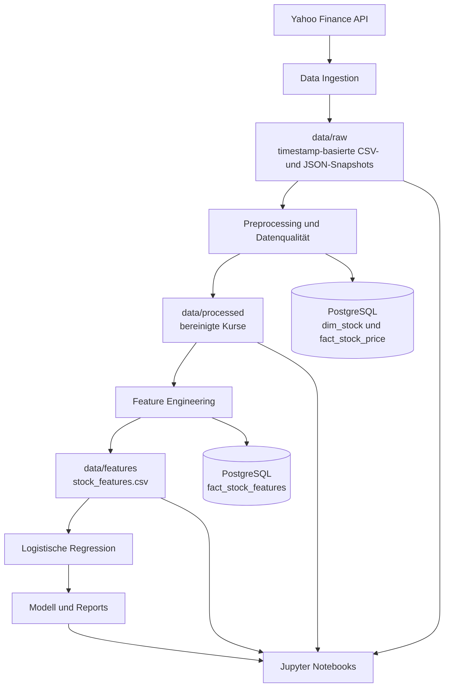

# Stock Forecasting Pipeline

## Stock Intelligence AI – neue lokale Webplattform

Dieses Repository enthält jetzt zusätzlich eine FastAPI-/React-Weboberfläche:
historisches Dashboard, Stock Radar, Aktienanalyse, News-/FinBERT-Anbindung,
Walk-Forward-Backtests, Model Analytics, Paper-Trading-Journal und Pipeline-Status.
Die bestehende Python-Pipeline und ihre Referenzartefakte bleiben erhalten.

**Start und Installation:** [docs/LOCAL_SETUP.md](docs/LOCAL_SETUP.md).
**Architektur/Features:** [docs/PLATFORM_ARCHITECTURE.md](docs/PLATFORM_ARCHITECTURE.md).
**Tatsächlicher Lieferstand und Prüfungen:** [docs/DELIVERY_REPORT.md](docs/DELIVERY_REPORT.md).
**Anbieter/Lizenzen:** [docs/PROVIDERS.md](docs/PROVIDERS.md).
**M2.2 Docker/Portainer:** [Schnellstart und Betrieb](docs/docker-deployment.md),
[technischer Bericht und offene Containerprüfungen](docs/M22_REPORT.md).
**M3 Financial News:** [Provider, lokale Konfiguration und Start](docs/live-news-intelligence.md),
[Implementierungs- und Testbericht](docs/M3_REPORT.md).
**M4.0 Forecast-Grundlage:** [Datenvertrag, lokale Modellartefakte und Tests](docs/M4_0_FORECAST_FOUNDATION.md).
**M4.1 Research Forecasts:** [Geschützte Prognosen, Persistenz und offener Holdout-Nachweis](docs/M4_1_RESEARCH_FORECASTS.md).
[M4.1 Abschluss und retrospektive Diagnose](docs/M4_1_COMPLETION.md) ·
[M4.2 Implementierungsplan](docs/M4_2_CURRENT_MARKET_DATA_PLAN.md) ·
[Prospektives Evaluationsprotokoll v1](docs/M4_2_PROSPECTIVE_EVALUATION_V1.md).
**M4.2a Tageskurse:** [Manueller Abruf, Revisionshistorie und Point-in-Time-Daten](docs/M4_2A_MARKET_DATA_INGESTION.md).
**M4.2b Current Research:** [Gesperrte Aktivierung, Forecast-Paare, Outcomes und begrenzte Automation](docs/M4_2B_FORECAST_AUTOMATION.md).

Der kostenlose Offline-Start zeigt die echten historischen Repository-Snapshots.
Live-Daten, News und Prognosen werden nicht simuliert. Next-Day-Modelltraining
ist als kalibrierte historische Forschung ausführbar; aktive Prognosen benötigen
eine unabhängige Freigabe. Intraday ist mangels geeigneter Daten deaktiviert.

Nach Installation der Webabhängigkeiten und `pnpm build` in `frontend`:

```powershell
.\.venv\Scripts\python.exe -m uvicorn src.platform.api:app --host 127.0.0.1 --port 8000
```

Die folgenden Abschnitte dokumentieren weiterhin den ursprünglichen PoC.

End-to-End-Proof-of-Concept für die Seminararbeit:

> **Konzeption einer skalierbaren Datenarchitektur für eine KI-Anwendung zur
> Prognose von Aktienkursbewegungen auf Basis historischer Marktdaten**

Das Projekt lädt historische Aktienkurse über Yahoo Finance, archiviert
unveränderte API-Snapshots, bereinigt und validiert die Daten, erzeugt
Zeitreihen-Features, speichert die Ergebnisse in PostgreSQL und trainiert eine
nachvollziehbare Machine-Learning-Baseline.

Der Schwerpunkt liegt auf **Datenarchitektur, Datenqualität und
Reproduzierbarkeit**. Das Modell ist ein technischer Abnehmer der Pipeline und
keine Handelsstrategie.

## Projektstatus

Der Proof of Concept ist vollständig Ende-zu-Ende ausführbar.

- Datenaufnahme für `AAPL`, `MSFT`, `NVDA`, `SAP.DE` und `ALV.DE`
- timestamp-basierte Raw-Snapshots für Kurse und Unternehmensprofile
- automatisches Preprocessing mit Datenqualitätsregeln
- PostgreSQL-Datenmodell mit idempotenten Upserts
- sechs technische Features und eine Zielvariable
- chronologischer Train/Test-Split ohne zufällige Zeitreihenmischung
- logistische Regression als transparente Modell-Baseline
- vier ausgeführte Analyse-Notebooks mit eingebetteten Visualisierungen
- automatisierte Unit Tests
- zentrale Pipeline-Orchestrierung über einen einzigen Befehl

Referenzlauf vom **25.08.2026**:

| Prüfung | Ergebnis |
|---|---:|
| Aktien | 5 |
| Bereinigte Kurszeilen | 6.312 |
| Featurezeilen | 6.312 |
| Duplikate | 0 |
| Ungültige OHLC-Zeilen | 0 |
| Fälschlich erzeugte Wochenenddaten | 0 |
| Kurszeilen ohne zugehörige Featurezeile | 0 |

## Architektur



Die einzelnen Schichten sind bewusst getrennt:

1. **Ingestion:** Ruft Daten ab und schreibt ausschließlich in den Raw Layer.
2. **Preprocessing:** Bereinigt und validiert den neuesten Snapshot.
3. **Feature Engineering:** Berechnet Merkmale getrennt je Ticker.
4. **Model Baseline:** Trainiert und bewertet ein einfaches Klassifikationsmodell.
5. **Notebooks:** Visualisieren Datenfluss, Qualität, Features und Modellgüte.

Eine detailliertere technische Beschreibung steht in
[`docs/architecture.md`](docs/architecture.md).

## Voraussetzungen

- Python 3.14 – mit dieser Version wurde der Referenzlauf geprüft
- PostgreSQL
- Internetzugriff für neue Yahoo-Finance-Abfragen
- Windows PowerShell für die folgenden Beispielbefehle

Die verwendeten Paketversionen sind in
[`requirements.txt`](requirements.txt) festgehalten.

## Installation

### 1. Repository klonen

```powershell
git clone https://github.com/Basti070301/stock-forecasting-pipeline.git
Set-Location -LiteralPath 'stock-forecasting-pipeline'
```

### 2. Virtuelle Python-Umgebung erstellen

```powershell
python -m venv .venv
.\.venv\Scripts\python.exe -m pip install --upgrade pip
.\.venv\Scripts\python.exe -m pip install -r requirements.txt
```

Die folgenden Befehle verwenden den Python-Interpreter direkt aus `.venv`.
Eine manuelle Aktivierung der Umgebung ist dadurch nicht erforderlich.

### 3. PostgreSQL konfigurieren

Die PostgreSQL-Datenbank muss bereits existieren. Anschließend wird die
Konfigurationsvorlage kopiert:

```powershell
Copy-Item .env.example .env
```

Erforderliche Variablen:

```dotenv
DB_HOST=localhost
DB_PORT=5432
DB_NAME=stock_forecasting
DB_USER=postgres
DB_PASSWORD=replace_me
```

Die lokale `.env` ist in `.gitignore` eingetragen und wird nicht versioniert.

Verbindung prüfen und fehlende Tabellen anlegen:

```powershell
.\.venv\Scripts\python.exe -m src.database --init
```

Eine erfolgreiche Ausgabe enthält beispielsweise:

```text
Database connection successful.
Database schema initialized.
dim_stock: 5 rows
fact_stock_price: 6312 rows
fact_stock_features: 6312 rows
```

## Pipeline verwenden

### Empfohlener vollständiger Aktualisierungslauf

```powershell
.\.venv\Scripts\python.exe -m src.pipeline --ingest --period 5y --replace
```

Dieser Befehl führt die komplette Pipeline aus:

```text
Aktuelle Yahoo-Daten abrufen
→ neuen Raw-Snapshot speichern
→ neuesten Snapshot bereinigen
→ PostgreSQL-Kurse kontrolliert ersetzen
→ Features neu berechnen
→ Featuretabelle ersetzen
→ Modell neu trainieren
→ Kennzahlen und Prognosen aktualisieren
```

Für den aktuellen PoC ist dieser vollständige Rebuild die empfohlene
Betriebsart. Die Datenmenge ist klein und der Datenbankstand entspricht dadurch
immer exakt dem neuesten Fünfjahres-Snapshot.

`--replace` betrifft ausschließlich die fünf konfigurierten PoC-Ticker. Die
zugehörigen Preis- und Featurezeilen werden innerhalb von Transaktionen neu
geschrieben. Die Raw-Snapshots bleiben erhalten und ermöglichen jederzeit eine
Rekonstruktion.

### Vorhandene Raw-Daten erneut verarbeiten

```powershell
.\.venv\Scripts\python.exe -m src.pipeline --replace
```

Dieser Modus benötigt keinen Internetzugriff. Er ist sinnvoll, wenn sich Code,
Datenqualitätsregeln oder Features geändert haben.

### Dateipipeline ohne PostgreSQL

```powershell
.\.venv\Scripts\python.exe -m src.pipeline --ingest --period 5y --no-database
```

Dabei werden Raw-, Processed-, Feature-, Modell- und Reportdateien erzeugt,
ohne die Datenbank zu verwenden.

### Idempotenter Wiederholungslauf

```powershell
.\.venv\Scripts\python.exe -m src.pipeline
```

Die vorhandenen Daten werden erneut verarbeitet und per Upsert geschrieben.
Die eindeutigen Datenbankschlüssel verhindern Duplikate.

## Was verändert ein Pipeline-Lauf?

| Artefakt | Verhalten bei einem neuen Lauf |
|---|---|
| `data/raw/prices/` | neuer Kurs-Snapshot wird ergänzt |
| `data/raw/profiles/` | neuer Profil-Snapshot wird ergänzt |
| `data/processed/prices/` | aktueller bereinigter Stand wird überschrieben |
| `data/features/stock_features.csv` | wird vollständig neu berechnet |
| `dim_stock` | Unternehmensdaten werden aktualisiert |
| `fact_stock_price` | Kurse werden ersetzt oder per Upsert aktualisiert |
| `fact_stock_features` | Features werden ersetzt oder per Upsert aktualisiert |
| `models/logistic_regression.joblib` | Modell wird neu trainiert |
| `reports/model_metrics.json` | Kennzahlen werden aktualisiert |
| `reports/model_predictions.csv` | Testprognosen werden aktualisiert |
| Notebook-Ausgaben | werden nicht automatisch aktualisiert |

Die Raw-Snapshots wachsen mit jedem Ingestion-Lauf. Für einen dauerhaften
Betrieb sollte daher später eine Aufbewahrungsregel ergänzt werden, zum Beispiel
„tägliche Snapshots 30 Tage, danach ein Snapshot pro Monat“.

## Regelmäßiger Betrieb

Für eine tägliche Aktualisierung kann der vollständige Pipeline-Befehl nach
Börsenschluss über die Windows-Aufgabenplanung gestartet werden. Ein möglicher
Zeitpunkt ist werktags gegen 23:30 Uhr in der Zeitzone `Europe/Berlin`.

Konfiguration einer Aufgabe:

| Feld | Wert |
|---|---|
| Programm | `<REPOSITORY>\.venv\Scripts\python.exe` |
| Argumente | `-m src.pipeline --ingest --period 5y --replace` |
| Starten in | `<REPOSITORY>` |

Die Pipeline ist idempotent. Eine erneute Ausführung mit demselben Snapshot
erzeugt keine doppelten Ticker-Datum-Kombinationen.

## Einzelne Verarbeitungsschritte

Die Komponenten können auch unabhängig ausgeführt werden:

```powershell
# Nur neue Raw-Snapshots abrufen
.\.venv\Scripts\python.exe -m src.ingestion --period 5y

# Neueste Snapshots bereinigen und in PostgreSQL schreiben
.\.venv\Scripts\python.exe -m src.preprocessing --replace

# Features erzeugen und Featuretabelle neu aufbauen
.\.venv\Scripts\python.exe -m src.feature_engineering --replace

# Baseline-Modell trainieren und Reports aktualisieren
.\.venv\Scripts\python.exe -m src.model_baseline
```

Für gewöhnliche Aktualisierungen sollte der zentrale Aufruf über
`src.pipeline` verwendet werden, da er die richtige Reihenfolge sicherstellt.

## Datenmodell

| Tabelle | Inhalt | Eindeutiger Schlüssel |
|---|---|---|
| `dim_stock` | Unternehmensstammdaten | `ticker` |
| `fact_stock_price` | bereinigte Tageskurse | `stock_id, trade_date` |
| `fact_stock_features` | technische Features und Zielvariable | `stock_id, trade_date` |

Das SQL-Schema befindet sich in
[`sql/create_tables.sql`](sql/create_tables.sql). Praktische Analyseabfragen
stehen in [`sql/sample_queries.sql`](sql/sample_queries.sql).

## Datenqualität

Das Preprocessing prüft unter anderem:

- Vorhandensein der notwendigen OHLCV-Spalten
- konvertierbare Kalenderdaten und numerische Werte
- eindeutige Ticker-Datum-Kombinationen
- positive Kernpreise
- `high_price` als Tagesmaximum
- `low_price` als Tagesminimum
- nicht negatives Handelsvolumen
- korrekte exchange-lokale Handelstage

Der Handelstag wird als lokales Kalenderdatum der jeweiligen Börse behandelt.
Dadurch werden deutsche Mitternachtswerte nicht durch eine UTC-Konvertierung
auf den vorherigen Tag verschoben.

## Feature Engineering

Alle Features werden je Ticker und in chronologischer Reihenfolge berechnet.

| Feature | Bedeutung |
|---|---|
| `daily_return` | prozentuale Veränderung zum vorherigen Handelstag |
| `moving_average_7` | gleitender Mittelwert der letzten 7 Handelstage |
| `moving_average_30` | gleitender Mittelwert der letzten 30 Handelstage |
| `volatility_30` | Standardabweichung der Tagesrendite über 30 Tage |
| `momentum_7` | Kursveränderung gegenüber sieben Handelstagen zuvor |
| `volume_change` | prozentuale Veränderung des Handelsvolumens |
| `target_next_day_up` | `True`, wenn der nächste Schlusskurs höher ist |

Die erste Zeitspanne eines Tickers enthält aufgrund der Rolling Windows noch
fehlende Featurewerte. Die letzte Zeile jedes Tickers besitzt bewusst kein
Target, da zu diesem Zeitpunkt kein Folgetag bekannt ist. Diese Zeilen werden
für das Modelltraining ausgeschlossen, bleiben aber aus Gründen der
Nachvollziehbarkeit in der Featuretabelle erhalten.

## Modell-Baseline

Die Baseline verwendet:

- logistische Regression
- Standardisierung der numerischen Features
- One-Hot-Encoding des Tickers
- chronologischen 80/20-Split anhand eindeutiger Handelstage
- feste Modellkonfiguration für reproduzierbare Ergebnisse
- Vergleich mit der Mehrheitsklasse

Ergebnis des Referenzlaufs:

| Kennzahl | Wert |
|---|---:|
| Mehrheitsbaseline Accuracy | 0,534 |
| Modell Accuracy | 0,519 |
| Balanced Accuracy | 0,493 |
| Precision | 0,530 |
| Recall | 0,881 |
| F1 | 0,662 |
| ROC-AUC | 0,528 |

Das Modell übertrifft die einfache Mehrheitsbaseline nicht. Dieses Ergebnis ist
fachlich plausibel und wichtig für die Einordnung: Historische technische
Merkmale allein liefern in diesem Setup keine robuste Prognose der täglichen
Kursrichtung. Der Proof of Concept demonstriert die technische
Datenbereitstellung, nicht die Profitabilität einer Handelsstrategie.

## Analyse-Notebooks

Die Notebooks sind bereits ausgeführt. Tabellen und Diagramme sind deshalb beim
Öffnen unmittelbar sichtbar.

1. [`01_data_ingestion.ipynb`](notebooks/01_data_ingestion.ipynb) –
   Snapshot-Inventar, Unternehmensprofile und normalisierte Kursentwicklung
2. [`02_data_preprocessing.ipynb`](notebooks/02_data_preprocessing.ipynb) –
   Qualitätsvergleich, Plausibilitätsregeln und korrekte Handelstage
3. [`03_feature_engineering.ipynb`](notebooks/03_feature_engineering.ipynb) –
   Feature-Abdeckung, gleitende Durchschnitte, Korrelationen und Target-Balance
4. [`04_model_baseline.ipynb`](notebooks/04_model_baseline.ipynb) –
   Zeit-Split, Kennzahlen, Konfusionsmatrix, ROC-Kurve und Koeffizienten

Jupyter starten:

```powershell
.\.venv\Scripts\python.exe -m notebook
```

Nach einem neuen Datenlauf müssen die Notebooks mit **Run All** erneut
ausgeführt werden, wenn auch die eingebetteten Tabellen und Grafiken den neuen
Stand zeigen sollen.

Alternativ lassen sich alle vier Notebooks automatisiert aktualisieren:

```powershell
.\.venv\Scripts\python.exe -m nbconvert --to notebook --execute --inplace notebooks/01_data_ingestion.ipynb notebooks/02_data_preprocessing.ipynb notebooks/03_feature_engineering.ipynb notebooks/04_model_baseline.ipynb
```

## Tests und Validierung

Unit Tests ausführen:

```powershell
.\.venv\Scripts\python.exe -m unittest discover -s tests -v
```

Abgedeckt werden insbesondere:

- exchange-lokale Datumsbehandlung
- Entfernung unplausibler OHLC-Zeilen
- Trennung der Featureberechnung je Ticker
- fehlendes Target am Ende jeder Zeitreihe
- chronologischer Train/Test-Split

Datenbankstatus prüfen:

```powershell
.\.venv\Scripts\python.exe -m src.database
```

Aktuelle Modellkennzahlen anzeigen:

```powershell
Get-Content reports\model_metrics.json
```

## Projektstruktur

```text
stock-forecasting-pipeline/
|-- data/
|   |-- raw/
|   |   |-- prices/              # unveränderte Kurs-Snapshots
|   |   `-- profiles/            # unveränderte Unternehmensprofile
|   |-- processed/prices/        # bereinigte Kursdaten
|   `-- features/                # Featuredatei für ML
|-- docs/
|   `-- architecture.md
|-- notebooks/
|   |-- 01_data_ingestion.ipynb
|   |-- 02_data_preprocessing.ipynb
|   |-- 03_feature_engineering.ipynb
|   `-- 04_model_baseline.ipynb
|-- reports/
|   |-- model_metrics.json
|   `-- model_predictions.csv
|-- sql/
|   |-- create_tables.sql
|   `-- sample_queries.sql
|-- src/
|   |-- config.py
|   |-- database.py
|   |-- ingestion.py
|   |-- preprocessing.py
|   |-- feature_engineering.py
|   |-- model_baseline.py
|   `-- pipeline.py
|-- tests/
|-- .env.example
|-- requirements.txt
`-- README.md
```

Ein aktueller Raw-Snapshot bleibt als reproduzierbare PoC-Datenbasis im
Repository. Neu erzeugte Raw-Snapshots, Processed-Dateien, Featuredateien,
Prognosedateien und Modellartefakte werden standardmäßig nicht versioniert.

## Typische Fehler

### PostgreSQL-Verbindung schlägt fehl

- Prüfen, ob der PostgreSQL-Dienst läuft.
- `DB_USER`, `DB_PASSWORD`, `DB_NAME`, `DB_HOST` und `DB_PORT` in `.env` prüfen.
- Verbindung mit `python -m src.database` testen.

### Keine aktuellen Yahoo-Daten

- Internetverbindung prüfen.
- Pipeline später erneut ausführen, falls Yahoo Finance vorübergehend nicht
  erreichbar ist.
- Ohne Netzwerk kann weiterhin der gespeicherte Referenz-Snapshot verarbeitet
  werden.

### Notebook zeigt alte Ergebnisse

Die Pipeline aktualisiert nicht automatisch die eingebetteten Notebook-Ausgaben.
Das betreffende Notebook erneut vollständig ausführen oder den oben genannten
`nbconvert`-Befehl verwenden.

## Grenzen und mögliche Erweiterungen

- `yfinance` eignet sich für Forschung und Lehre, bietet aber keine produktive
  SLA oder garantierte Datenverfügbarkeit.
- Die Kurse werden mit `auto_adjust=True` geladen und sind um relevante
  Corporate Actions angepasst.
- Der aktuelle Rebuild hält den neuesten Fünfjahreszeitraum. Für ein dauerhaft
  wachsendes historisches Archiv wäre eine echte inkrementelle Ingestion die
  nächste Ausbaustufe.
- Nachrichten, Makrodaten, Transaktionskosten und Marktregime werden nicht
  berücksichtigt.
- Weitere sinnvolle Erweiterungen sind Pipeline-Logging mit Run-ID,
  Data-Quality-Monitoring, Airflow/Dagster, Cloud Object Storage, MLflow und
  Modell-Drift-Monitoring.

## Hinweis

Dieses Projekt dient ausschließlich Forschung und Lehre. Die Ergebnisse sind
keine Anlageberatung und keine Empfehlung zum Kauf oder Verkauf von
Finanzinstrumenten.
