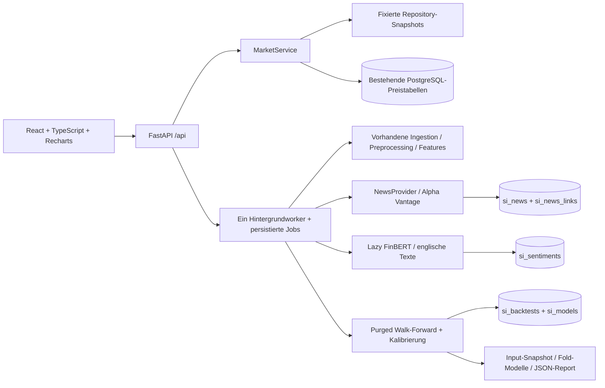

# Architektur und wissenschaftliche Verträge

## Komponenten

- `src/platform/api.py`: API, lokale Zugriffskontrolle, statischer Frontendbuild.
- `config.py`: getrennte Webkonfiguration und validierte Instrumentstammdaten.
- `store.py`: additive SQLAlchemy-Persistenz; Demo-SQLite / bestehendes PostgreSQL.
- `market.py`: reine Leser, Integration von `clean_price_frame` und
  `calculate_features`, Datenqualität und erklärbarer Radar-Score.
- `news.py`: Providerprotokoll, Alpha-Vantage-Adapter, Deduplizierung,
  Spracherkennung, lazy FinBERT und Herkunft.
- `research.py`: Training, separate Kalibrierung, Walk-Forward, Kosten und Reports.
- `intraday.py`: separate Minute-Bar-/Kalendergrenzen; keine Intraday-Prognosen.
- `jobs.py`: begrenzter In-Process-Worker, persistierte Zustände und Teilschritte.
- `frontend/src`: deutsche Oberfläche, Query-Cache, Diagramme und Fehlerzustände.

Es gibt keine zweite Raw-/Preprocessing-Pipeline. Webaktualisierung orchestriert
die vorhandenen Funktionen mit `replace_existing=False`. Die Original-CLI bleibt
unverändert. GET-Aufrufe schreiben keine Kursdaten, trainieren nicht und laden
FinBERT nicht. Demo-CSV-Bereinigung wird im Prozess gecacht.

## Zeit und Features

`trade_date` bleibt das börsenlokale Kalenderdatum, kein künstlicher UTC-Kurs.
Zusätzlich wird der geplante Sitzungsschluss aus `exchange_calendars` als UTC
ausgegeben; er ist keine Behauptung eines Tick-Zeitstempels. Der Forschungsweg
akzeptiert nur abgeschlossene Sitzungen. Kalender decken reguläre Feiertage,
Zeitzonen und verkürzte Handelstage ab; ungeplante Handelsunterbrechungen lassen
sich aus den vorhandenen Tagesdaten nicht vollständig rekonstruieren.

| Feature | Definition | Früheste Verfügbarkeit / fehlende Werte |
|---|---|---|
| daily_return | Close(t)/Close(t−1)−1 | Sitzungsschluss; erste Zeile fehlt |
| moving_average_7 | Mittel der letzten 7 Schlusskurse | nach 7 vorhandenen Sitzungen |
| moving_average_30 | Mittel der letzten 30 Schlusskurse | nach 30 vorhandenen Sitzungen |
| volatility_30 | Stichproben-Std. von 30 Tagesrenditen | nach 31 Kurszeilen; keine Annualisierung |
| momentum_7 | Close(t)/Close(t−7)−1 | nach 8 Kurszeilen |
| volume_change | Volume(t)/Volume(t−1)−1 | fehlendes/Null-Vorvolumen → fehlend |
| relative_volume | Volume(t)/Mittel Volume(t−20…t−1) | 20 vorherige Volumina; Referenz enthält nicht t |
| trend | Close(t)/MA30(t)−1 | abgeschlossene Sitzung, MA30 vorhanden |
| news_sentiment | Mittel positiver minus negativer FinBERT-Softmax-Scores | nur erfasste/analysierte englische News im Filterzeitraum |
| news_count | Anzahl zugeordneter News im Zeitraum | null bekannte News = 0, keine positive/negative Analyse behauptet |

Kursfeatures verwenden bestehende adjustierte Yahoo-Kurse. Fehlende technische
Werte bleiben `null`; es gibt keine Auffüllung mit Nullpreisen. Training verwirft
Zeilen mit unvollständigen Eingaben. Weitere News-Veränderungs-/Indexfeatures
sind nicht als implementiert ausgegeben.

## Radar v1

Score = Summe vier Komponenten, Bereich −100 bis +100:

- News: 40 × mittleres Sentiment im News-Zeitfenster.
- Momentum: 30 × clip(momentum_7 / 0,10, −1, 1).
- Volumen: 15 × clip(relative_volume − 1, 0, 1) × sign(momentum_7).
- Trend: 15 × clip((Close/MA30 − 1) / 0,10, −1, 1).

Fehlende Komponenten liefern keinen Beitrag; die verbleibenden Gewichte werden
nicht hochskaliert. Detailansicht zeigt alle Beiträge und fehlende Faktoren.
Nicht abgeschlossene Tagesbars liefern keine Momentum-/Trend-/Volumenbeiträge.
Nachrichten müssen sowohl nach Erst-Erfassung als auch nach Veröffentlichung
im gewählten Zeitraum liegen, nicht in der Zukunft. Alter der Kursdaten ist
separat sichtbar; älter als vier Kalendertage gilt als historisch/veraltet.
Diese Heuristik ersetzt keinen verzögerungsspezifischen Echtzeitvertrag.

Die Demo ordnet historische Kursfeatures ein; sie erzeugt keine heutigen News.
Der Score ist keine statistisch validierte Wahrscheinlichkeit und kein
Profitabilitätsnachweis. Modell-/Horizontfilter bleiben leer, solange keine
Prognosemodelle freigegeben sind.

## Walk-Forward und Kalibrierung

Ziel: `Close(nächste Sitzung) > Close(aktuelle Sitzung)`.
Vorhersagezeitpunkt ist nach Sitzungsschluss. Training startet standardmäßig mit
252 eindeutigen Daten; Kalibrierung 63, Testblock 63. Das Training wächst mit
jedem Block. Bei einem gemischten Universum sind dies eindeutige Handelstage
der Vereinigungsmenge, nicht für jeden Ticker dieselbe Zahl von Sitzungen.

Targets besitzen ein `label_end`. Trainingslabels müssen strikt vor Beginn der
Kalibrierung bekannt sein; Kalibrierungslabels strikt vor Beginn des Testblocks.
Es gibt keine zufällige Zeitmischung. Fehlende nächste Börsensitzungen werden
nicht durch die nächste beliebig verfügbare Kurszeile ersetzt.
Logistische Regression nutzt den vorhandenen Modellbuilder. Random Forest
verwendet 100 Bäume, Tiefe 5, mindestens 20 Blattbeobachtungen, Seed 42.
Eine eigene logistische Sigmoid-Kalibrierung wird ausschließlich im separaten
Kalibrierungsfenster auf den Logits der Modellwerte angepasst.

Die naive Vergleichsklasse und deren Wahrscheinlichkeit stammen ausschließlich
aus dem jeweiligen Training. Der alte PoC-Referenzbericht verwendet dagegen
die Mehrheitsverteilung im Test; diese methodische Grenze wird kenntlich gemacht.
Feature-Gewichte zeigen den letzten Fold: standardisierte LR-Koeffizienten oder
RF-Impurity-Importance, keine kausale Erklärung.

Alle Einzelvorhersagen im Report haben UTC-Zeitpunkte für Vorhersage,
simulierte Ausführung und beobachtetes Ergebnis. Sie sind historische
Forschungsprognosen, keine nachträglich in das Live-Journal geschriebenen Signale.

## Kosten, Rendite und Grenzen

Ein positives Signal (`p >= 0,5`) simuliert einen Long-Kauf zur nächsten
Sitzungseröffnung und Verkauf zum selben Sitzungsschluss. Sonst Cash.
Roundtrip-Kosten = 2 × Gebühr + Spread + 2 × Slippage, alle in Basispunkten.
Standard: 12 bps. Ein- und Ausstieg überlappen nicht mit der nächsten Position.
Das Close→Close-Klassifikationsziel und die ausführbare Open→Close-Rendite sind
bewusst separat; richtiger Klassifikationserfolg impliziert keine Nettorendite.

Feste gleichgewichtete Währungssleeves über das ausgewählte Universum, kein
Leverage, keine Shorts, fehlende Sitzungen verbleiben in Cash. Der Kapitalindex
verkettet tägliche mittlere Nettorenditen. Maximum Drawdown berücksichtigt
Startkapital 1. Precision@K wird nach Prognose-Handelstag berechnet.
Accuracy, Balanced Accuracy, Precision, Recall, F1, ROC-AUC, Brier Score,
Precision@K, Nettorendite und Drawdown werden tatsächlich berechnet.
Index-Überschussrendite ist `null`, da Benchmarkdaten fehlen.

Survivorship, point-in-time Corporate Actions, Handelsaussetzungen,
Liquidität/Marktimpact und FX sind nicht vollständig modelliert. Angepasste
Snapshots und eine kleine heutige Watchlist reichen nicht zum Nachweis einer
handelbaren oder profitablen Strategie. Ein News-Modell wird ohne historische
Erst-Erfassungsdaten nicht trainiert. Publikationszeit allein reicht nicht.

## Artefakte und Jobbetrieb

Jeder neue API-Backtest speichert Parameter, Daten-/Code-SHA256, Paketversionen,
Kalenderzuordnung, Folds, Metriken und Einzelvorhersagen in `si_backtests`.
Zusätzlich: `.runtime/<mode>/backtests/<UUID>/input.csv`, `report.json` und
`fold-NNN.joblib` mit jeweiligem Modell und Kalibrator. Modelldateien nur aus
vertrauenswürdigen lokalen Läufen laden; die API akzeptiert keine Pickle-Uploads.
Berichte sind append-only. Modus und Universum gehören zur nachvollziehbaren
Auswertung. Die Dateiablage muss zusammen mit der DB gesichert werden.

Ein Hintergrundworker führt immer nur einen teuren Job aus, konkurrierende
POSTs erhalten 409. HTTP antwortet mit 202/Job-ID; Ergebnisse werden gepollt.
Schritte und Fehler bleiben gespeichert. Neustarts markieren unfertige Jobs
als unterbrochen. Keine Multiworker-/verteilte Queue und kein automatischer
Scheduler. Der Server muss für laufende Jobs geöffnet bleiben.

## Prognosefreigabe / bewusst noch offen

Es gibt derzeit keine freigegebenen Next-Day- oder Intraday-Modelle und keinen
automatischen Freigabeschalter. Ein einzelner Backtest ist keine unabhängige
Validierung. Next-Day-Training und Kalibrierung sind im Forschungsweg ausführbar;
ein operativer Forecast-Scheduler und die Ergebniserfassung sind noch zu ergänzen,
sobald ein dokumentiertes Modellfreigabeverfahren und frische Daten vorliegen.

Das Paper-Trading-Journal ist lesbar und technisch append-only mit getrennten
Outcomes vorbereitet, bleibt ohne freigegebene Prognosequelle leer.
Intraday hat separate Schema-/Kalendergrenzen für 60/120 Handelsminuten, aber
noch keinen Minutenprovider und keine Feature-/Trainingspipeline. Tagesdaten
werden niemals in Minutenkurse umetikettiert. Diese Teile sind nicht fertig
als operative Prognosefunktionen ausgegeben.
