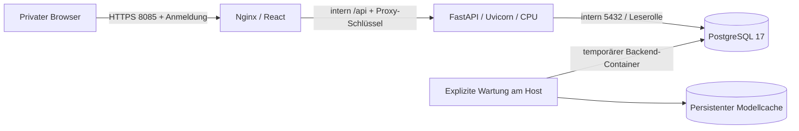

# M2.2 – Docker und Portainer

Aktueller historischer Teststand: [M4.3 Docker Preview](M4_3_DOCKER_PREVIEW.md).
Dort stehen die M4-Migrationen, Offline-Research-Artefakte, Port 8086 und die
inzwischen praktisch ausgeführten lokalen Containerprüfungen. Die folgenden
M2.2-Angaben beschreiben die ursprüngliche Basiskonfiguration auf Port 8085.

Stand: 09.10.2026. Vorbereitet für eine private Ubuntu-VM auf Proxmox,
Docker Standalone/Compose und Portainer. Kein Deployment auf einem realen
Server vorgenommen. **Containerlaufzeit noch nicht abgenommen:** der lokale
Docker-Linux-Daemon war nicht erreichbar. Praktische und statische Prüfungen
stehen getrennt in [M22_REPORT.md](M22_REPORT.md).

## Schnellstart

Voraussetzungen: laufende Docker Engine mit Compose-Plugin, Python 3.12+
für die kleinen Host-Helfer, Git, Linux/amd64. Befehle im Repository ausführen.
Bestehende Stacks unverändert lassen. Port 8085 vorab auf Verfügbarkeit prüfen.
Unter Ubuntu `python3`, unter Windows das vorhandene `python` bzw.
`.venv\Scripts\python.exe` verwenden. Die Helfer benötigen nur die Standardbibliothek.

```bash
# 1. Einmalig: neue, zufällige Kennwörter; existierende Datei wird nie überschrieben.
python3 scripts/configure_docker.py
docker compose --env-file .env.docker -f compose.yaml -f compose.build.yaml config --quiet

# 2. Images bauen. Keine FinBERT-Gewichte während des Builds.
docker compose --env-file .env.docker -f compose.yaml -f compose.build.yaml build --pull

# 3. Nur die eigene Datenbank starten, dann explizit initialisieren.
docker compose --env-file .env.docker up -d --wait --wait-timeout 120 si-postgres
python3 scripts/docker_admin.py init-db
python3 scripts/docker_admin.py import-reference
python3 scripts/docker_admin.py check-writes

# 4. Einmaliger, ausdrücklich ausgelöster Modelldownload (~440 MB).
python3 scripts/docker_admin.py download-model
python3 scripts/docker_admin.py check-model

# 5. Gesamten Stack starten.
docker compose --env-file .env.docker up -d --wait --wait-timeout 180
docker compose --env-file .env.docker ps
```

Browser am Docker-Host: **https://127.0.0.1:8085**. Benutzer `research`, Kennwort
aus `SI_AUTH_PASSWORD` in der privaten `.env.docker`. Das initial erzeugte
Zertifikat ist selbstsigniert: vor dem Anmelden Fingerabdruck über den
vertrauten Docker-Host prüfen und das Zertifikat gezielt vertrauen. Für den
Dauerbetrieb ein Zertifikat der internen CA einsetzen. HTTP ist nicht aktiviert.

```bash
docker compose --env-file .env.docker exec si-frontend \
  openssl x509 -in /var/lib/si-tls/server.crt -noout -sha256 -fingerprint -dates
```

Auf einer entfernten Ubuntu-VM ist `127.0.0.1` deren Loopback, nicht der Laptop.
Modus A ist beispielsweise über einen lokalen SSH-Tunnel erreichbar:
`ssh -N -L 8085:127.0.0.1:8085 benutzer@private-vm-ip`.
Danach auf dem Laptop dieselbe HTTPS-URL verwenden.

## Architektur und Ressourcen



| Service | Prozess / UID | Erreichbarkeit | Standardlimit |
|---|---|---|---|
| `si-frontend` | Nginx, 101:101 | Host-IP:8085 → TLS 8443 | 192 MiB / 0,5 CPU |
| `si-backend` | Uvicorn, 10001:10001, ein Worker | intern 8000 | 4 GiB / 2 CPU |
| `si-postgres` | PostgreSQL, 999:999 | ausschließlich intern 5432 | 1 GiB / 1 CPU |

Planungswert: **4 vCPU, 8 GiB RAM, mindestens 30 GiB freie SSD** für die VM;
zusätzlicher Platz für Images, Buildcache, historische Daten und Backups.
Andere Stacks benötigen eigene Reserve. Gemessen wurde nur ein nativer
Windows-FinBERT-Prozess mit zwei kurzen Inferenzläufen: **883,5 MiB Peak Working
Set**. Das ist weder Container-RSS noch ein Lasttest. Unter Ubuntu zunächst
`docker stats` und `docker_admin.py check-model` (Peak-RSS) messen. Ein
zusätzlicher Wartungscontainer kann weitere 4 GiB beanspruchen; nicht parallel
zu speicherintensiven Jobs starten. Keine GPU erforderlich oder konfiguriert.

`si-app` und `si-database` sind interne Compose-Netze. `si-edge` trägt den
Frontend-Hostzugriff; `si-egress` ermöglicht dem Backend/Wartungscontainer
ausgehende Provider-/Modelldownloads. Alle Namen erhalten den Projektpräfix.
Keine globalen `container_name`, externen Netze oder Host-Netzwerkmodi.

Volumes, ebenfalls pro Projekt:

| Volume | Inhalt | UID / Behandlung |
|---|---|---|
| `si-pgdata` | PostgreSQL-Cluster, Unterordner `pgdata` | 999; nur PostgreSQL |
| `si-runtime` | Forschungsartefakte/Laufzeitdateien | 10001; sichern |
| `si-data` | spätere Raw-/Processed-/Feature-Dateien | 10001; sichern |
| `si-cache` | `HF_HOME` sowie Pipeline-Caches | 10001; dauerhaft |
| `si-tls` | TLS-Zertifikat und privater Schlüssel | 101; vertraulich sichern |

Die versionierten Raw-Referenzen liegen zusätzlich unveränderlich im
Backend-Image unter `/app/reference/raw`. Der Import liest dort direkt;
bestehende Raw-Dateien in Volumes werden weder kopiert noch ersetzt.
Docker legt neue benannte Volumes mit den Besitzrechten der Image-Verzeichnisse
an. Bei übernommenen Volumes erst Besitzer prüfen; keine pauschalen rekursiven
chmod/chown-Befehle auf bestehende Daten anwenden. `check-writes` erstellt und
entfernt eine temporäre Datei in jedem Backend-Schreibbereich. Container-Logs
gehen nach stdout/stderr, benötigen kein beschreibbares `/app/logs`.

## Docker auf Ubuntu installieren

Eine bestehende Docker-Installation dieses Servers wird nicht ersetzt.
Zuerst `docker version`, `docker compose version`, `docker context show`,
`docker ps` und `ss -ltn` prüfen. Für eine neue VM das offizielle Docker-APT-
Repository mit signiertem Schlüssel einrichten; anschließend `docker-ce`,
`docker-ce-cli`, `containerd.io`, `docker-buildx-plugin`, `docker-compose-plugin`
installieren. Die vollständigen, zum Ubuntu-Release passenden Schritte stehen
in der [Docker-Installationsanleitung](https://docs.docker.com/engine/install/ubuntu/).
Ein unterstütztes Ubuntu LTS verwenden, z. B. 24.04 oder 26.04.

Keine automatische Deinstallation, kein Convenience-Skript und keine
Serverinstallation sind Teil dieses Repositories. Zugriff auf den Docker-
Daemon entspricht weitreichenden Host-Rechten; nur Administratoren erhalten
diesen Zugriff. Die Befehle oben setzen diesen Zugriff voraus.

## Konfiguration und private Zugriffsmodi

`.env.docker.example` beschreibt die Variablen. `configure_docker.py` generiert
vier getrennte zufällige Secrets und schreibt unter Unix mit Modus 0600.
Unter Windows zusätzlich die NTFS-Berechtigungen der Datei auf das eigene
Konto prüfen. `.env.docker` ist von Git und Docker-Build-Kontext ausgeschlossen.
Keine Kennwörter in Befehlsargumenten oder Terminalprotokolle kopieren.
`docker compose config` ohne `--quiet` würde Secrets ausgeben.

| Variable | Bedeutung |
|---|---|
| `COMPOSE_PROJECT_NAME` | Stabile Stackidentität; Standard `stockintelligence` |
| `SI_BIND_IP` | Explizite Hostadresse, standardmäßig `127.0.0.1` |
| `SI_PUBLIC_HOST` | Browser-Hostname/IPv4, Hostprüfung und Zertifikat-SAN |
| `SI_PORT` | Freier Hostport, Standard 8085 |
| `SI_AUTH_USER`, `SI_AUTH_PASSWORD` | Browseranmeldung; Passwort mindestens 20 Zeichen |
| `SI_PROXY_TOKEN` | Interner Proxy-Schlüssel, mindestens 32 Hex-Zeichen |
| `SI_DB_ADMIN_PASSWORD` | PostgreSQL-Owner `si_owner`, nur DB und explizite Wartung |
| `SI_DB_APP_PASSWORD` | Nur lesender API-Benutzer `si_reader` |
| `SI_FRONTEND_IMAGE`, `SI_BACKEND_IMAGE` | Lokale Release-Tags oder Registry-Digests |
| `SI_BACKEND_MEMORY`, `SI_BACKEND_CPUS`, `SI_DB_MEMORY` | Grenzen; nach Messung anpassen |
| `SI_ALPHA_VANTAGE_KEY` | Optional eigener bestehender Provider-Key; kein Abonnement |

**Modus A – Loopback:** Generator ohne Zusatzargumente. Kein Zugriff aus LAN
oder Internet; Zugriff direkt am Host oder über SSH-Tunnel.

**Modus B – explizite private Adresse:** vor der ersten Konfiguration:

```bash
python3 scripts/configure_docker.py --bind 192.168.1.50 --host 192.168.1.50
# Alternativ genau die vorhandene Tailscale-IP des Docker-Hosts:
# python3 scripts/configure_docker.py --bind 100.90.80.70 --host 100.90.80.70
```

Beispieladressen durch tatsächlich am Host konfigurierte Adressen ersetzen.
Der Generator lehnt öffentliche, Wildcard- und Link-Local-Adressen ab. Es gibt
absichtlich nur eine Portbindung: LAN- und Tailnet-IP werden nicht gleichzeitig
veröffentlicht. Bestehende Datei bewusst bearbeiten, nicht neu generieren.
Bei Hoständerung passendes TLS-Zertifikat installieren und Stack neu erstellen.
Passwörter und Projektname dabei erhalten.

Keine Router-Portweiterleitung, kein UPnP, Cloudflare, Tailscale Funnel oder
öffentliche Veröffentlichung. Tailscale ist optional und wird hier nicht
installiert/umkonfiguriert. Vorhandene Tailnet-Zugriffsregeln sollen auf die
eigenen Geräte begrenzen. Private IP **ersetzt keine Anmeldung**; Basic Auth
bleibt auf UI und `/api` aktiv und wird nur über TLS übertragen. Ein
gemeinsames Konto eignet sich nur für den privaten Einzelanwenderbetrieb.
Es gibt keine Mehrbenutzerverwaltung oder öffentliche Login-Härtung.

Docker-Published-Ports können UFW-Regeln umgehen; Host-/Proxmox-Firewall und
Docker-Regelwerk zusammen prüfen, insbesondere erlaubte Quellgeräte und
IPv6. Siehe die [Docker-Firewall-Hinweise](https://docs.docker.com/engine/install/ubuntu/#firewall-limitations).
In diesem Stack wird kein IPv6-/Wildcard-Hostport freigegeben.

## HTTPS und späterer interner Reverse Proxy

Der erste Frontendstart erzeugt ein selbstsigniertes RSA-Zertifikat für genau
`SI_PUBLIC_HOST`, gültig für 365 Tage. Neustarts verwenden dieselben Dateien.
Zertifikate rechtzeitig vor Ablauf ersetzen. Bei unvollständigem Zertifikat/
Schlüsselpaar startet Nginx nicht. Zertifikatswechsel ist eine bewusste
Administratoraktion, kein automatischer Dateiersatz.

Eigenes CA-Zertifikat mit passendem SAN und Schlüssel in `si-tls` installieren
(Besitzer 101:101, Schlüssel 0600); beispielsweise am vertrauenswürdigen Host:

```bash
docker compose --env-file .env.docker exec -T si-frontend sh -c \
  'umask 077; cat > /var/lib/si-tls/server.crt.new' < intern-fullchain.pem
docker compose --env-file .env.docker exec -T si-frontend sh -c \
  'umask 077; cat > /var/lib/si-tls/server.key.new' < intern-private-key.pem
docker compose --env-file .env.docker exec -T si-frontend sh -c \
  'mv /var/lib/si-tls/server.crt.new /var/lib/si-tls/server.crt; mv /var/lib/si-tls/server.key.new /var/lib/si-tls/server.key'
docker compose --env-file .env.docker restart si-frontend
```

Ein späterer interner HTTPS-Proxy kann an die private/Loopback-HTTPS-Adresse
weiterleiten, das interne CA-Zertifikat prüfen und denselben öffentlichen
Hostheader/SNI erhalten. `SI_PUBLIC_HOST` auf diesen DNS-Namen setzen. Bei
abweichendem Browserport `SI_ALLOWED_ORIGINS` im Backend über einen lokalen
Compose-Override auf den genauen Ursprung anpassen; keine `*`-Origins/Hosts.
Der Browser verwendet weiter relative `/api`-URLs, kein Backend-DNS im JS.

Nginx überschreibt eingehende Forwarded-Header, entfernt Basic-Authorization
beim Backend-Aufruf und setzt den internen Proxy-Schlüssel. Uvicorn vertraut
mit `--no-proxy-headers` keinen fremden IP-/Schemaangaben. Die Anwendung
benötigt diese nicht für absolute URLs; Logs zeigen gegebenenfalls die
Proxyadresse. Erst bei einer späteren bewussten Erweiterung feste vertrauenswürdige
Proxyadressen konfigurieren, niemals `forwarded-allow-ips=*`. Die zusätzliche
Basic-Anmeldung bleibt auch hinter dem internen Proxy erhalten. Hier wird
kein vorhandener Proxy geändert oder an vorhandene Netze angeschlossen.

## PostgreSQL, Migration und Referenzimport

PostgreSQL 17 (aufgelöstes Image 17.11/bookworm) ist per Manifest-Digest
fixiert. Die [PostgreSQL-Versionsrichtlinie](https://www.postgresql.org/support/versioning/)
nennt Unterstützung für Major 17 bis November 2029. Sicherheitsupdates der
17er-Reihe später bewusst mit neuem Digest testen; kein automatischer Majorwechsel.

`init-db` ist ein expliziter Einmal-/Updatebefehl. Er führt die versionierten
SQL-Dateien in einer Transaktion und unter PostgreSQL-Advisory-Lock aus:

- `001_reference.sql`: vorhandene `dim_stock`, `fact_stock_price`,
  `fact_stock_features` und Indizes, ausschließlich `CREATE IF NOT EXISTS`.
- `002_platform.sql`: additive `si_*`-Tabellen für Instrumente, News, Links,
  Sentiments, Modelle, Prognosen, Outcomes, Backtests, Jobs, Intraday/Provider.
- `si_deployment_migrations`: Dateiname, SHA256 und Anwendungszeitpunkt.
  Nachträglich veränderte angewendete Migrationen führen zum Abbruch.

Bestehende Tabellen/Daten werden nicht gelöscht oder neu aufgebaut. Für spätere
Schemaänderungen neue nummerierte SQL-Datei ergänzen, alte Migrationen nicht
umschreiben. Abweichende Fremdschemata vorher auf einer Restore-Kopie prüfen:
`CREATE IF NOT EXISTS` konvertiert keine inkompatiblen Spalten automatisch.
Die native v1-Migration bleibt weiterhin für die bisherige Windows-App verfügbar.

`si_owner` wird nur im PostgreSQL-Container und in ausdrücklich gestarteten
Wartungscontainern verwendet. `si_reader` erhält SELECT/USAGE/CONNECT und keine
Trainings-/Datenänderungsrechte. Bei bestehendem Leserollenkonto ändert
`init-db` dessen Passwort absichtlich nicht. Keine automatische Passwortrotation.
Hat eine vorhandene Rolle erhöhte Rechte, Rollenmitgliedschaften oder
Schreibrechte auf öffentliche Tabellen, bricht die Einrichtung ab; es werden
keine vorhandenen Berechtigungen stillschweigend entzogen.
Kennwortänderungen müssen DB-Rolle und `.env.docker` gemeinsam aktualisieren;
das bloße Ändern von `POSTGRES_PASSWORD` ändert keine bestehende Datenbank.

Der Import liest ausschließlich die fünf eingefrorenen Snapshots vom
25.08.2026. Ein erneuter Import fügt keine vorhandenen Schlüssel hinzu
(`ON CONFLICT DO NOTHING`), aktualisiert auch keine bereits vorhandenen Preise,
Profile oder Features und trainiert kein Modell. Fehlende Features werden
aus den tatsächlich erhaltenen DB-Kursen berechnet. Alle Ticker werden
gemeinsam transaktional importiert; Fehler rollen den gesamten Import zurück.
Auf einer neuen Datenbank sind 5 Stammsätze und 6312 Kurs-/Featurezeilen zu
erwarten; diese Zahl ist aus den lokalen Referenzen bekannt, die Container-
Importprüfung ist noch offen. Es erfolgt kein automatischer Import beim Start.

Vor der Übernahme einer bestehenden Datenbank: Backup und Restore-Probe in
einem **neuen** Projekt/Volume, dann Migration/Import prüfen. Nie ein fremdes
PostgreSQL-Volume direkt anbinden. Kein `--replace`, `DROP`, `TRUNCATE`,
`down -v` oder `volume prune` in diesem Betriebsablauf.

## FinBERT und Wartung

Modell: [ProsusAI/finbert, feste Revision](https://huggingface.co/ProsusAI/finbert/tree/4556d13015211d73dccd3fdd39d39232506f3e43)
`4556d13015211d73dccd3fdd39d39232506f3e43`. PyTorch ist im Docker-Lock explizit
als `+cpu` gebunden. `HF_HOME=/app/.cache/huggingface`, Hub-Unterordner `hub`,
persistiert im `si-cache`-Volume. Keine Gewichte im Git oder Image.

Standard `HF_HUB_OFFLINE=1`: fehlende Gewichte führen zu einer verständlichen
Fehlermeldung, nicht zu einem unerwarteten Download. Nur `download-model`
setzt für diesen Wartungscontainer explizit Offline=0. Nach dem Download
funktioniert `check-model` ohne Netzwerk. Hugging-Face-Variablen müssen vor
dem Python-Prozess gesetzt sein, siehe [HF-Umgebungsvariablen](https://huggingface.co/docs/huggingface_hub/package_reference/environment_variables).
Der bisherige Windows-Cache wird ohne gesetztes HF_HOME weiterverwendet.

Das Modell wird lazy einmal pro Prozess geladen, Aufrufe sind gesperrt gegen
parallele Initialisierung. Ein Containerneustart lädt es erneut in RAM, aber
nicht erneut aus dem Netz. `check-model` führt zwei synthetische, nicht
gespeicherte Inferenztests aus und zeigt Cachetreffer und Peak-Speicher.
`analyze-news` verarbeitet vorhandene englischsprachige News explizit am Host:
`python3 scripts/docker_admin.py analyze-news`. Jeder Wartungsaufruf ist ein
eigener kurzlebiger Prozess, verwendet jedoch dasselbe persistente Cache-Volume.

Der Server-Webzugriff ist lesend: Nginx blockiert Schreibmethoden, FastAPI
deaktiviert Mutationen zusätzlich, die DB-Rolle ist lesend. Bestehende
UI-Schaltflächen bleiben aus Gründen des unveränderten Designs sichtbar,
Schreibaktionen werden im Serverbetrieb abgewiesen. Native Windows-Funktionen
einschließlich Backtests bleiben verfügbar. Öffentliche Trainings-/Import- oder
Administrationsendpoints gibt es im Dockerprofil nicht. API-Dokumentation ist
dort abgeschaltet. `/api/health` prüft den Prozess, `/api/ready` DB-Verbindung
und erwartete Schemaversion; beide extern ebenfalls hinter Nginx-Anmeldung.
FinBERT ist bewusst kein Startup-Healthcheck, damit ein fehlendes Modell die
historische Kursansicht nicht verhindert.

## Portainer

Ziel: **Docker Standalone**, kein Swarm. `compose.yaml` enthält ausschließlich
Images und benannte Volumes, keine relativen Bind-Mounts oder Build-Kontexte.
`compose.build.yaml` ist ausschließlich der zusätzliche CLI-Buildweg.
Portainer-Builds aus Git hängen von Version/Edition/Endpoint ab und werden
hier ausdrücklich nicht vorausgesetzt. [Offizielle Stack-Dokumentation](https://docs.portainer.io/user/docker/stacks/add).

Empfohlener Ablauf:

1. Images per CLI auf **demselben Docker-Endpoint** bauen. Alternativ geprüfte
   Images aus einer eigenen Registry bereitstellen oder `docker image save` /
   `docker image load` verwenden. Ein lokaler Desktop-Build existiert nicht
   automatisch auf der VM. Es wird nichts automatisch gepusht.
2. Mit dem gewünschten finalen Projektnamen Datenbank und Wartung aus dem
   Schnellstart ausführen. CLI-erstellte Stacks erscheinen gegebenenfalls in
   Portainer zunächst mit eingeschränkter Verwaltung.
3. Für vollständige Portainer-Verwaltung den eigenen CLI-Stack mit
   `docker compose --env-file .env.docker down` stoppen (ohne Volumelöschung).
   Portainer → Stacks → Add Stack; **denselben Namen** wie
   `COMPOSE_PROJECT_NAME` wählen. Vor Deploy kontrollieren, dass die bestehenden
   projektbezogenen Volumes wiederverwendet werden.
4. Webeditor: `compose.yaml` einfügen. Alle Werte der `.env.docker` als
   Portainer-Stack-Umgebungsvariablen setzen/importieren. Portainer schützt sie
   nicht vor berechtigten Administratoren; Zugriff beschränken. Nicht in Git
   ablegen. Lokale Images müssen mit den angegebenen Tags vorhanden sein;
   nicht blind die Option zum erneuten Pull lokaler Tags aktivieren.
5. Alternativ Git-Repository `https://github.com/Basti070301/stock-forecasting-pipeline`,
   freigegebenen Commit/Branch und Compose-Pfad `compose.yaml` wählen. **Der
   lokale M2.2-Branch wurde nicht gepusht**; Git-Deployment ist erst möglich,
   nachdem der Nutzer die Bereitstellung dieses Commits genehmigt hat.
   Weder `.env.docker` noch das Build-Override aus Git laden lassen.
6. Deploy, Healthzustand und Containerlogs prüfen. Stacks → Stack → Container →
   Logs zeigt stdout/stderr; Healthchecks stehen im Containerstatus.

Für spätere CLI-Wartung am Host weiterhin denselben Projektnamen und dieselben
Secrets verwenden. Nicht parallel einen zweiten Portainer-Stack unter anderem
Namen starten und erwarten, dass er dieselben Daten automatisch findet.

## Backup und Wiederherstellung

PostgreSQL logisch mit `pg_dump` sichern; eine Kopie eines laufenden
PGDATA-Verzeichnisses ist kein konsistenter Ersatz. Diese Beispiele sind
**Bash auf Ubuntu**, nicht PowerShell-Binärausgabeumleitungen:

```bash
set -euo pipefail
umask 077
mkdir -p backups
stamp=$(date -u +%Y%m%dT%H%M%SZ)
docker compose --env-file .env.docker exec -T si-postgres sh -c \
  'PGPASSWORD="$POSTGRES_PASSWORD" exec pg_dump -h 127.0.0.1 -U "$POSTGRES_USER" -d "$POSTGRES_DB" --no-owner --no-acl -Fc' \
  > "backups/stockintel-$stamp.dump"
test -s "backups/stockintel-$stamp.dump"
sha256sum "backups/stockintel-$stamp.dump" > "backups/stockintel-$stamp.dump.sha256"
```

Backup verschlüsselt auf getrennten Datenträger/Backupziel kopieren, regelmäßig
Restore üben und Aufbewahrung festlegen. `.env.docker` getrennt verschlüsselt
sichern. Zusätzlich Runtime-, Daten- und TLS-Volumes nach Abschluss aller
Wartungsjobs sichern. Beispielsweise über nur für dieses Projekt gestartete
Maintenance-Container mit `tar` und expliziten Volume-Namen. Für konsistente
Dateibestände währenddessen Backend/Frontend des **eigenen** Stacks stoppen;
keine anderen Stacks stoppen. Der Cache ist erneut herunterladbar, eine
Sicherung erlaubt aber Offline-Restore. Image-Digests/Release-Konfiguration
gehören zum Backupmanifest. Proxmox-Snapshots nur mit konsistenter DB-Sicherung
als zusätzliche Ebene verwenden.

Konkrete Datei-Backups bei laufendem lesendem Backend, **ohne parallel laufende
Wartungscontainer** (Bash, gleiche `stamp`-Variable wie oben):

```bash
docker compose --env-file .env.docker exec -T si-backend \
  tar -C /app -czf - .runtime data > "backups/files-$stamp.tar.gz"
docker compose --env-file .env.docker exec -T si-frontend \
  tar -C /var/lib/si-tls -czf - server.crt server.key > "backups/tls-$stamp.tar.gz"
# Optional für einen Offline-Restore:
docker compose --env-file .env.docker exec -T si-backend \
  tar -C /app/.cache -czf - huggingface > "backups/model-cache-$stamp.tar.gz"
```

Restore immer zuerst in ein neues leeres Testprojekt mit anderem Hostport.
Neue `.env.docker` dafür erzeugen, nur `si-postgres` starten. Den Dump vor
`init-db` in die frisch angelegte leere DB laden:

```bash
# Hier zeigt .env.docker ausschließlich auf das neue Restore-Projekt!
docker compose --env-file .env.docker exec -T si-postgres sh -c \
  'PGPASSWORD="$POSTGRES_PASSWORD" exec pg_restore -h 127.0.0.1 -U "$POSTGRES_USER" -d "$POSTGRES_DB" --no-owner --no-acl --exit-on-error --single-transaction' \
  < backups/stockintel-BACKUPZEIT.dump
python3 scripts/docker_admin.py init-db
```

Kein `--clean`: bei nichtleerer Ziel-DB abbrechen und eine neue leere Restore-DB
anlegen. `init-db` erzeugt danach die eigene Leserolle/Grants, prüft Migrationen
und bewahrt importierte Datensätze. Anschließend passende Datei-Volumes
wiederherstellen, Cache prüfen, Stack starten und Datenzeilen/Ansichten mit
dem Backup vergleichen. Ein Rollback des Originals erfolgt erst nach
erfolgreicher Probe; automatisches Ersetzen produktiver Daten ist nicht vorgesehen.

Datei-Restore nur aus den eigenen vertrauenswürdigen Archiven in die neuen
Restore-Volumes, bevor Frontend/Backend gestartet werden:

```bash
docker compose --env-file .env.docker run --rm --no-deps -T si-backend \
  tar -C /app -xzf - < backups/files-BACKUPZEIT.tar.gz
docker compose --env-file .env.docker run --rm --no-deps -T --entrypoint tar si-frontend \
  -C /var/lib/si-tls -xzf - < backups/tls-BACKUPZEIT.tar.gz
docker compose --env-file .env.docker run --rm --no-deps -T si-backend \
  tar -C /app/.cache -xzf - < backups/model-cache-BACKUPZEIT.tar.gz
```

## Updates und Rollbacks

1. Backup + Restore-Probe, laufende eigene Wartungsjobs beenden. Aktuelle
   Image-IDs/Digests, `.env.docker`, Compose und Quellcommit sichern.
2. Neuen Release mit eigenen unveränderlichen Tags konfigurieren, z. B.
   `stockintelligence-backend:m22-20261008-1`, gleiches Frontend-Schema.
   `docker compose --env-file .env.docker -f compose.yaml -f compose.build.yaml build --pull`.
   Alle Linux-Builds, Tests, Image-Sicherheitsprüfung und Modelltest durchführen.
3. Explizit `python3 scripts/docker_admin.py init-db` mit dem neuen Backend-Image
   ausführen, wenn Migrationen anstehen. Niemals Migrationen beim normalen
   Containerstart verstecken. Dann `docker compose --env-file .env.docker up -d --wait`
   bzw. in Portainer Imagewerte aktualisieren und redeployen.
4. Daten, Anmeldung, Health, Modellcache und Logs prüfen. Benannte Volumes und
   Projektname bleiben erhalten. `restart: unless-stopped` startet beendete
   Prozesse neu; **unhealthy allein löst keinen Docker-Neustart aus**.

Rollback: vorherige kompatible Image-Tags/Digests wieder einsetzen und redeployen.
M2.2-Migrationen sind additiv; Daten bleiben bestehen. Für zukünftige
inkompatible Schemaänderungen zunächst Restore in ein neues Volume/Projekt
mit den alten Images testen. Kein automatisches Downgrade, keine automatische
Rücksetzung von Daten. Alte Images erst nach erfolgreicher Abnahme und Ablauf
des Rollbackfensters entfernen. PostgreSQL-Majorupgrades sind separate Vorhaben.

Basen sind per Digest fixiert, Frontendpakete über pnpm-Lock, Python inklusive
transitiver Abhängigkeiten und Hashes über `requirements-docker.lock`.
Linux/amd64/Python 3.12 ist das Buildziel. Lock neu auflösen mit dem im Lockkopf
dokumentierten uv-Befehl (uv 0.10.9). Der CPU-Index enthält ausschließlich die
gewählte CPU-Torch-Variante. Betriebssystempakete und Wheel-Buildwerkzeuge sind
nicht vollständig als bitidentischer Build eingefroren; für identische
Rollbacks immer das tatsächlich getestete Image/Digest aufbewahren.

## Prüfungen und Fehlerbehebung

Isolierten lokalen Teststack vorbereiten, mit neuem Dateinamen falls die
Standardkonfiguration schon existiert:

```bash
python3 scripts/configure_docker.py --output .env.m22-test --project stockintelligence-m22-test --port 8085
python3 scripts/docker_smoke.py --env-file .env.m22-test --build --model
# Nach Installation der bisherigen Frontend-Dev-Abhängigkeiten:
node scripts/docker_browser_smoke.mjs .env.m22-test
```

Der Smoke-Test ist auf Test-Projektnamen und Loopback begrenzt. Er prüft
Migration, doppelten Seed, Schreibrechte, TLS/Auth, API, Inferenz und Erhalt der
Kurse/des Zertifikats nach Container-Neuerstellung. Er lässt den Teststack
für Browser-/Logprüfungen laufen und entfernt keine Volumes. Aufräumen durch
`docker compose --env-file .env.m22-test down`, Daten bleiben erhalten.
Für Edge unter Windows vor dem Browsertest `$env:SI_TEST_EDGE='1'` setzen.
Screenshots/Logs werden unter `.runtime/m22-docker` abgelegt.

| Symptom | Prüfung / Abhilfe |
|---|---|
| Docker-Pipe nicht gefunden | Desktop/Engine läuft nicht; keine erfolgreichen Builds behaupten |
| Bind/Port belegt | `ss -ltn` bzw. `Get-NetTCPConnection`; freie private Adresse/Port wählen |
| Frontend wartet / Backend unhealthy | DB-Health, explizites `init-db`, Schemaversion 2 und Logs prüfen |
| 401 | HTTPS-Anmeldedaten aus richtiger privater Konfiguration verwenden |
| 403 bei Schreiben | Absichtlich lesender Serverbetrieb; Wartung am Host ausführen |
| 400/444 | Browser-Host, `SI_PUBLIC_HOST`, SNI/SAN und erlaubte Hosts abgleichen |
| TLS-Warnung / abgelaufen | CA/Fingerabdruck prüfen und passendes Zertifikat ersetzen |
| Modellgewichte fehlen | `download-model`, danach `check-model`, gleiches Cache-Volume |
| Permission denied | Tatsächliche UID/Volume-Besitzer und `check-writes`; kein chmod 777 |
| DB-Passwort geändert, Login schlägt fehl | Bestehende DB-Rolle bewusst rotieren; Env allein genügt nicht |
| Daten nach Redeploy scheinbar leer | Projektname/Volume-Namen prüfen, nicht erneut neu initialisieren |
| OOM / Exit 137 | `docker stats`, VM-Reserve und Limits prüfen, parallele Modellprozesse vermeiden |

Logs: `docker compose --env-file .env.docker logs --tail 100 si-backend si-postgres si-frontend`.
Rotation begrenzt pro Container auf 3 × 10 MB. Kein Docker-Socket-Mount,
keine privilegierten Container, alle Linux-Capabilities entfernt, Root-Dateisysteme
schreibgeschützt, explizite tmpfs/Volumes und PID-Limits. Secrets in Env sind
für Docker-/Portainer-Administratoren sichtbar; deren Zugriffsrechte sind Teil
der Vertrauensgrenze. Vor echtem Einsatz Images auf aktuelle Schwachstellen
prüfen; ein vollständiger CVE-Scan wurde hier mangels gebauter Images nicht ausgeführt.

## Windows bleibt unterstützt

`.env` und `.env.docker` sind getrennt. Native Installation und Start stehen
unverändert in [LOCAL_SETUP.md](LOCAL_SETUP.md):

```powershell
.\.venv\Scripts\python.exe -m uvicorn src.platform.api:app --host 127.0.0.1 --port 8000
```

Frontend-Build bleibt `pnpm build` im Ordner `frontend`, Entwicklungsproxy
auf 5173 → 8000. Native Demo nutzt weiter SQLite und vorhandene Raw-Snapshots;
die Datenpipeline und das UI-Design wurden für M2.2 nicht verändert.
