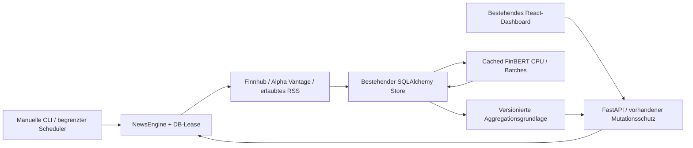

# M3 – Live Financial News Intelligence

Branch: `codex/m3-live-news-intelligence`, Ausgangspunkt `f8fac37`.
Die Engine ist implementiert und lokal mit Provider-Mocks, SQLite, API,
Frontend und echter CPU-Inferenz geprüft. **Echte Providerabrufe sind noch
nicht abgenommen:** kein API-Key und kein ausdrücklich erlaubter RSS-Feed
sind in der Entwicklungsumgebung konfiguriert. Keine Nachrichten werden als
Fallback erfunden. Docker-Laufzeit gehört nicht zu M3.

## Architektur



Die bestehende `Store`-Architektur bleibt bestehen: SQLite im lokalen Demo-
Kursmodus und PostgreSQL im bisherigen Live-Kursmodus. Echte Nachrichten
können mit `SI_NEWS_ENABLED=true` **unabhängig** von historischen Kursen
lokal gespeichert werden. Es ist kein Docker/PostgreSQL nötig, um das
News-Modul mit einem zulässigen Zugang unter Windows zu verwenden.
Die Datenherkunft der Nachrichten wird getrennt vom Kursmodus angezeigt.

Adapter liefern das vorhandene validierte `Article`-Modell. `NewsEngine`
erledigt Beobachtung, Upserts/Revisionen, Zuordnung, Analyse und Aggregation.
API/CLI/Scheduler benutzen denselben Code. Es gibt keine zweite ETL-Pipeline,
kein zusätzliches Broker-, Prognose- oder Paper-Trading-Modul.

## Providerentscheidung und Nutzungsbedingungen

| Provider | Technischer Zugang | Abdeckung in M3 | Entscheidung |
|---|---|---|---|
| Finnhub Company News | Registrierter API-Key, persönlicher Testzugang prüfen | AAPL, MSFT, NVDA | Primärer Adapter, reale Nutzung noch BLOCKED |
| Alpha Vantage NEWS_SENTIMENT | Eigener API-Key und passende Endpoint-/Kontingentberechtigung | Bestätigte US-Symbole | Vorhandenen Parser wiederverwendet, Alternative |
| Offizielles RSS/Atom | Öffentlicher HTTPS-Feed plus ausdrückliche Speicher-/Analyseberechtigung | Konfigurierter Emittent und kontrollierte Aliase | Opt-in Adapter, keine ungeprüften Defaultfeeds |

Finnhub dokumentiert Company News für nordamerikanische Unternehmen. Auth
erfolgt über `X-Finnhub-Token`, wie im
[offiziellen Go-Client](https://github.com/Finnhub-Stock-API/finnhub-go) beschrieben.
Die kanonische API-Domain folgt dem
[offiziellen Python-Client](https://github.com/Finnhub-Stock-API/finnhub-python/blob/master/finnhub/client.py).
Kein deutscher ADR wird automatisch als `SAP.DE` oder `ALV.DE` ausgegeben.

Die [Finnhub-Bedingungen](https://finnhub.io/terms-of-service) begrenzen
persönliche Pläne auf die berechtigte individuelle Nutzung. Zugang zu Daten
und abgeleiteten Ergebnissen darf ohne schriftliche Zustimmung nicht mit
Dritten geteilt werden. Bei Ende eines Datenabonnements verlangen sie
Löschung der betroffenen Daten. Ein kostenloser Zugang ist daher keine
pauschale Weitergabe- oder Urheberrechtslizenz. Nur der eigene private Zugriff
ist Gegenstand dieser Implementierung; Speicher-/Analyse- und etwaige
Zusammenfassungsrechte vor Aktivierung konkret prüfen.

[Finnhub Registrierung und Planinformationen](https://finnhub.io/) /
[Pricing](https://finnhub.io/pricing): persönlichen kostenlosen Zugang wählen,
Kontoberechtigungen/aktuelle Quoten prüfen und Key aus dem eigenen Dashboard
in `.env` hinterlegen. Es wurde kein Konto angelegt oder Tarif gebucht.
Der Adapter setzt selbst keine kostenpflichtige Berechtigung voraus; ob der
konkrete Account `company-news` liefert, muss mit einem echten Abruf geprüft werden.

[Alpha-Vantage-Dokumentation](https://www.alphavantage.co/documentation/#news-sentiment)
beschreibt einen tickergefilterten News-Endpoint; Free-Key-Erwerb über
[Support](https://www.alphavantage.co/support/#api-key). Ein Key allein belegt
keine Endpoint-Berechtigung. Eine allgemeine Premium-Pflicht wird aus der
aktuellen Dokumentationsüberschrift nicht abgeleitet. Die
[Bedingungen](https://www.alphavantage.co/terms_of_service/) behandeln persönliche
nicht kommerzielle Nutzung; weitergehende Nutzung separat vereinbaren.
M3 begrenzt Alpha Vantage konservativ auf höchstens 25 HTTP-Versuche/UTC-Tag.

RSS ist **kein automatischer Rechtebeleg**. Beispielsweise bietet SAP
[offizielle Feeds](https://news.sap.com/germany/rss-feeds-sap-news-center/), aber die
[aktuellen Websitebedingungen](https://www.sap.com/germany/about/legal/terms-of-use.html)
beschränken automatisierte Extraktion/Indexierung und KI-Nutzung ohne ausdrückliche
Erlaubnis. Deshalb wird kein SAP-Feed ungeprüft aktiviert. Gleiches Vorgehen
bei Allianz-/anderen Emittentenfeeds: URL, Inhalt, Nutzungsumfang und schriftliche
Freigabe prüfen. Es erfolgt kein Scraping von Artikelwebseiten, keine Paywall-
Umgehung und keine Annahme einer Lizenz allein aufgrund öffentlicher Sichtbarkeit.

Standard: nur Titel, Quelle, Link und Metadaten. Keine Vollartikel und keine
Provider-Kurzfassungen. `SI_NEWS_STORE_SUMMARIES=true` erst mit ausreichenden
Rechten; API-Zusammenfassungen werden dann auf 800 Zeichen begrenzt. RSS-
Volltext/Description wird auch dann nicht übernommen. Rechtebestätigung ist
eine Operator-Konfiguration, keine von der Software gewährte Lizenz.
Bei `SI_NEWS_RIGHTS_ACCEPTED=false` sind Abruf/Analyse und Anzeige gespeicherter
Providerinhalte gesperrt. Das ersetzt **keine** vertraglich erforderliche
Löschung: betroffene Nachrichten, Revisionen und Ableitungen bei Lizenzende
kontrolliert durch den DB-Owner entfernen lassen. Keine automatische Löschung
historischer Daten wird ausgeführt.

## Konfiguration und Windows-Schnellstart

Bestehende `.env` ergänzen, niemals überschreiben oder committen. `.env.example`
enthält nur leere Keys/Platzhalter. API-Key ausschließlich lokal im Editor
eintragen, nicht in Chat, Shellargumente, Screenshots oder Git.

Minimal für echte US-Nachrichten und historische lokale Kursdaten:

```dotenv
SI_MODE=demo
SI_NEWS_ENABLED=true
SI_NEWS_PROVIDER=finnhub
SI_FINNHUB_KEY=
# Erst nach Prüfung des eigenen Nutzungsumfangs auf true setzen:
SI_NEWS_RIGHTS_ACCEPTED=false
SI_NEWS_STORE_SUMMARIES=false
SI_FINBERT_ENABLED=true
SI_FINBERT_DEVICE=-1
SI_NEWS_AUTO_REFRESH=false
```

Der leere Key/das false-Rechteflag sind absichtlich nicht lauffähiger Live-Zugang.
Key im eigenen Konto beziehen und Rechte erst nach Prüfung bestätigen.
Kein Providerzugang nötig, um die App mit ehrlichen leeren Newszuständen zu starten.

```powershell
# Vorhandene Installation weiterverwenden. Falls noch nicht installiert:
.\.venv\Scripts\python.exe -m pip install -r requirements-finbert.txt
if (-not (Test-Path .env)) { Copy-Item .env.example .env }

# FinBERT einmal bewusst in den bisherigen lokalen Cache laden/prüfen:
.\.venv\Scripts\python.exe -m scripts.check_finbert

# UI bauen:
Set-Location frontend
pnpm install --frozen-lockfile
pnpm build
Set-Location ..

# Konfigurationsstatus: zeigt keine Schlüsselwerte.
.\.venv\Scripts\python.exe -m src.platform.news_scheduler status

# Einzelner kontrollierter Abruf; erst mit gültigem, zulässigem Zugang:
.\.venv\Scripts\python.exe -m src.platform.news_scheduler refresh --ticker MSFT

# App starten (bleibt lokal):
.\.venv\Scripts\python.exe -m uvicorn src.platform.api:app --host 127.0.0.1 --port 8000
```

Browser: `http://127.0.0.1:8000`. News Intelligence → Providerstatus/Feed,
Aktien-Detail → News & AI Sentiment, Dashboard → Market News Intelligence.
Nach Konfigurationsänderungen Backend neu starten. Bestehende `.env`-Keys
und Windows-Startskripte bleiben erhalten. Optional `SI_MUTATION_TOKEN`
wie bisher konfigurieren und in Einstellungen eingeben.

Bei noch nicht geladenen Gewichten nur den expliziten Modelldownload erlauben.
Für anschließenden sicheren Offlinebetrieb vor Start/Inferenz:
`$env:HF_HUB_OFFLINE='1'`. Ohne HF_HOME wird der bestehende Windows-Cache
`.cache/huggingface` weiterverwendet; mit HF_HOME liegt der Hub-Cache darunter
in `hub`, optional explizites HF_HUB_CACHE. Fehlende Gewichte erzeugen einen
verständlichen Fehler und keine Ersatzscores.

## RSS-Konfiguration für freigegebene europäische Quellen

Es gibt keine voraktivierten RSS-Feeds. Nach dokumentierter Erlaubnis:

```dotenv
SI_NEWS_PROVIDER=rss
SI_NEWS_RSS_FEEDS=[{"name":"Freigegebene Emittentenquelle","url":"https://VERIFIZIERTE-QUELLE.invalid/feed.xml","ticker":"SAP.DE","rights_confirmed":true,"license_reference":"Kennung der geprüften ausdrücklichen Erlaubnis"}]
```

Die `.invalid`-URL ist ein **nicht funktionierender Platzhalter**, kein echter
Provider. Durch tatsächliche öffentliche HTTPS-URL ersetzen; `ticker` ist
optional, für Emittentenfeeds nach Identitätsprüfung sinnvoll. Maximal zehn
Feeds. Keine Zugangsdaten in Feed-URLs. Fehlende Freigabe, private IPs/Hostnamen,
private DNS-Ziele oder unsichere XML-DTD/Entities werden abgewiesen.
Redirects werden nicht blind verfolgt. Nur vom Betreiber kontrollierte,
vertrauenswürdige Feedkonfiguration verwenden; die URL ist kein öffentlicher
API-Parameter. Kein Clientschutz verspricht eine vollständige DNS-Rebinding-
Abwehr gegen bösartige Administrator-Konfiguration.

RSS/Atom benötigt eine tatsächliche `pubDate`/`published`-Zeit mit Zeitzone.
Fehlende/ungültige Veröffentlichung, Zukunftsdatum oder ungültiger Link wird
verworfen; eine Änderungszeit wird nicht als Veröffentlichungszeit erfunden.
Mehrsprachige Meldungen bleiben sichtbar, FinBERT wertet nur erkannte englische
Texte aus. Alias-Zuordnung und Emittentenfeed-Zuordnung sind unterscheidbar.

## Ingestion, Idempotenz und Zeitkorrektheit

- HTTP-Timeout 20 Sekunden, höchstens drei Versuche bei Transport-/5xx-Problemen,
  Backoff 1/2 Sekunden. Kein Retry bei 401/403/429, strukturierter Fehlerstatus.
- Antworten werden gestreamt und bei mehr als 2 MiB abgebrochen. Quellen
  begrenzen zusätzlich auf 250 JSON-/100 RSS-Einträge pro Anfrage.
- HTTP-Versuche werden **vor** der Anfrage persistiert, einschließlich Retry.
  Globales Budget `SI_NEWS_DAILY_BUDGET=100`; Alpha konservativ höchstens 25.
  API-Zyklen mindestens 60 Sekunden auseinander, RSS mindestens 15 Minuten.
  `Retry-After` wird als Abrufsperre respektiert; keine Kontingentumgehung.
- Eine modebezogene Datenbank-Lease schützt Abruf und Analyse über Backend/
  CLI-Prozesse hinweg. 30 Minuten TTL, Heartbeat pro Datensatz/Batch/Request;
  bei Verlust Abbruch, Besitzerprüfung beim Freigeben. Die vorhandene Job-
  Queue verhindert zusätzliche Parallelität im API-Prozess.
- Canonical-URL-Hash ist die interne News-ID. Trackingparameter/Fragmente
  erzeugen keine neuen Meldungen. News, Revision und Links committen atomar.
- `first_seen_at`: tatsächliche erste lokale Beobachtung, nie rückdatiert.
  `last_updated_at`: letzter bestätigter Abruf dieses Datensatzes.
  `version_observed_at`: erste Beobachtung dieser konkreten Text-/Metadataversion.
  `published_at` kommt vom Anbieter in UTC; `original_published_at` bewahrt
  den zuerst gesehenen Veröffentlichungswert bei Providerkorrekturen.
- Unveränderte Wiederholung erzeugt keine neue News oder Analyse. Änderungen
  erzeugen append-only Revisionen. Neuer Titel/Kurzfassung benötigt neue Analyse.
- Point-in-time-Abfragen wählen nur bis `as_of` tatsächlich beobachtete
  Revisionen/Links/Analysen. Eine rückwirkend entdeckte Nachricht steht davor
  nicht zur Verfügung. Das baut noch kein Prognose-/News-Backtestmodell.

Logausgaben enthalten Provider-ID und Fehlercode, keine vollständigen
Antworten, API-Keys oder Request-URLs mit Tokens. Alpha-Query-Keys werden in
HTTPX-Logs redigiert. Providerfehler werden persistent im Status geführt.
Teilweise erfolgreiche Läufe sind als solche markiert; vollständig
fehlgeschlagene API-/Schedulerjobs erhalten keinen Erfolgsstatus.

## Aktienzuordnung

| Aktie | Primäre Zuordnung | Grenzen |
|---|---|---|
| AAPL | Exaktes Finnhub-Symbol AAPL | Alias nur eindeutiges Apple Inc., nicht beliebiges Wort apple |
| MSFT | Exaktes Symbol MSFT | Wortgrenze für Microsoft/Corporation |
| NVDA | Exaktes Symbol NVDA | Wortgrenze für NVIDIA/Corporation |
| SAP.DE | Bestätigter eigener Emittentenfeed oder Alias SAP SE | Kein automatisches SAP-ADR-Mapping; kein freigegebener Feed vorhanden |
| ALV.DE | Bestätigter Emittentenfeed oder Allianz/Allianz SE | Kein geprüfter Live-Feed vorhanden |

Provider-Ticker haben Vorrang. `related` wird als exakte Symbolliste gelesen,
nicht per Teilstring. Eine Meldung kann mehrere Titel betreffen. Jeder Link
enthält Zuordnungsmethode und Treffer. Weitere bestätigte API-Mappings lassen
sich im Adapterregister ergänzen; freigegebene neue Emittentenfeeds können
auf weitere Watchlist-Ticker zeigen. Keine automatische Unternehmensrecherche
oder mutmaßliche Börsenplatzzuordnung erfolgt beim Abruf.

## FinBERT und Aggregation

Bestehendes `ProsusAI/finbert`, Revision
`4556d13015211d73dccd3fdd39d39232506f3e43`. Lazy-Prozesscache und Modell-Lock
bleiben bestehen. M3 nutzt CPU, Standardbatch 8 (konfigurierbar 1–32), maximal
512 Tokens. Es werden nur Titel bzw. ausdrücklich erlaubte Kurzfassungen
analysiert, keine Artikel nachgeladen oder automatisch übersetzt.

Gespeichert: positive/negative/neutral, dominierende Klasse (höchste
Wahrscheinlichkeit), `positive-negative` im Bereich −1 bis +1, Input-Hash,
Inputumfang, Modellname/-revision und tatsächlicher Analysezeitpunkt.
Spracherkennung ist heuristisch (langdetect, deterministisch, >=90 %);
nicht englische/unklare Texte bleiben ohne Sentimentscore. Alte Ergebnisse
ohne passenden Input-Hash gelten nicht automatisch als geprüfte Analyse und
müssen neu analysiert werden. Title-only-Sentiment hat weniger Kontext.

Fenster 24 Stunden/7 Tage/30 Tage verwenden tatsächlich verfügbare und
analysierte Meldungen. Gleiche URL bleibt ein Datensatz; gleichartige Geschichten
über verschiedene URLs erhalten nur eine Stimme. Nahe Duplikate werden
konservativ über Wortnormalisierung, hohe Ähnlichkeit, gleiche Firmen und
48-Stunden-Abstand gruppiert; abweichende Zahlen oder bedeutungstragende
Wörter (z. B. höher/niedriger) verhindern Zusammenfassung. Reposts verschieben
die erste Verfügbarkeit der Geschichte nicht in ein jüngeres Fenster.

Gleiches Gewicht je Geschichte; positive/negative/neutral nach dominierender
Modellklasse. Unanalysierte Geschichten zählen nicht zum Mittelwert; fehlendes
Sentiment bleibt `null`, nicht 0. Unter fünf Analysen erscheint ein Hinweis.
Verlauf wird nach erster Beobachtung/UTC-Tag aufgeteilt. Basis enthält Zeitfenster,
Stichtag, News-/Analyse-IDs, ausgeschlossene Duplikate, Regelversion und SHA256.
Jobs persistieren die letzte Aggregationsgrundlage; GETs sind rein lesend.
Revisionen und Analysen bleiben zur erneuten Berechnung historischer Stichtage
erhalten. Keine Gleichsetzung mit einer zuverlässigen Kursprognose.

## Datenbank und additive Migration

Vorhandene Tabellen werden genutzt: `si_news`, `si_news_links`, `si_sentiments`,
`si_provider_calls`, `si_jobs`, `si_instruments`. Neue Dokumenttabellen:

| Tabelle | Inhalt |
|---|---|
| `si_news_revisions` | Unveränderliche beobachtete Text-/Metadataversionen |
| `si_provider_status` | Letzter Versuch/Erfolg/Fehler, Cooldown, Empfangsanzahl |
| `si_news_aggregates` | Letzte nachvollziehbare Basis pro Aktie/Zeitfenster |
| `si_news_locks` | Besitzer und Ablauf der prozessübergreifenden Lease |

Alle verwenden das vorhandene Schema id/mode/created_at/payload (JSON).
SQLite startet additiv wie bisher. Native PostgreSQL-Konfiguration:

```powershell
# Gegen die richtige DB und mit vorhandenen Schema-Owner-Rechten:
.\.venv\Scripts\python.exe -m src.platform.store --migrate
```

Die Metadatenmigration ergänzt nur fehlende Plattformtabellen und Marker v3.
Die versionierte Datei `sql/migrations/003_news_intelligence.sql` enthält
dieselben additiven PostgreSQL-Tabellen/Indizes. Der bestehende explizite
Docker-Maintenance-Migrationslauf übernimmt sie samt Prüfsumme und Marker v3,
wenn später bewusst aktualisiert wird. Migration 001/002 bleiben unverändert.
Keine Fachkurse, Features, Modellmetriken oder Rohdaten werden verändert.
PostgreSQL-Laufzeit wurde hier mangels Testinstanz nicht geprüft.

## API

| Endpoint | Verhalten |
|---|---|
| GET `/api/news` | Bisherige Array-Schnittstelle, ticker/days; echte Status-/Analysefelder |
| GET `/api/news/feed` | Paginierter Feed: ticker, source, provider, days, sentiment, page, page_size, as_of |
| GET `/api/news/providers` | Gewählter/unterstützte Provider, Abdeckung, letzter Erfolg/Fehler, Schedulerstatus; keine Keys |
| GET `/api/news/summary` | Kompakte Watchlist-Aggregate und letzte Meldungen |
| GET `/api/stocks/{ticker}/news` | Bestehende kompatible Aktien-News-Schnittstelle |
| GET `/api/stocks/{ticker}/sentiment` | Drei Zeitfenster und Verlauf, optional as_of |
| POST `/api/news/refresh` | `{ticker: "MSFT"}` oder `{ticker:null}` für unterstützte Watchlist; kontrollierter Job |
| POST `/api/news/analyze` | Batchanalyse noch nicht passender englischer Texte |

Pagination maximal 100 Einträge/Seite, standardmäßig 20. Antwort liefert
`as_of`; für Folgeseiten denselben Stichtag verwenden. Das Frontend friert
ihn je Filter-/Aktualisierungsdurchlauf ein. Fehler/Parameter ungültig führen
zu 4xx statt erfundenen Ergebnissen. Mutationsschutz bleibt unverändert:
Loopback oder konfigurierte Tokens, Host-/Originprüfung; im Docker-Leseprofil
sind POSTs weiterhin deaktiviert und durch Nginx zusätzlich abgesperrt.

## Automatische Aktualisierung ohne Browser

Manuell: News Intelligence → Nachrichten abrufen (ggf. FinBERT automatisch,
falls aktiviert), oder CLI. Optional Backend-Scheduler:

```dotenv
SI_NEWS_AUTO_REFRESH=true
SI_NEWS_INTERVAL_SECONDS=900
SI_NEWS_MAX_CYCLES=24
SI_NEWS_DAILY_BUDGET=100
```

Nur mit eingeschaltetem News-Modul, geprüftem Zugang/Rechten, vorhandenem
Schema und erlaubten Mutationen. Ein Worker wie bisher verwenden.
Der Scheduler lebt im Backendprozess, nicht im Browser. Er führt höchstens
die konfigurierte Anzahl Versuche pro Prozess aus, wartet abbrechbar und
überspringt belegte Job-Queue. DB-Lease schützt auch gegenüber CLI-Aufrufen.
Ein Backendneustart startet das Zyklusbudget neu, das persistente HTTP-
Tagesbudget/Cooldown bleibt bestehen. Kein Redis/Celery/Cron eingerichtet.

Alternativ expliziter begrenzter CLI-Prozess:

```powershell
.\.venv\Scripts\python.exe -m src.platform.news_scheduler schedule --cycles 4
# Oder nur vorhandene Texte analysieren:
.\.venv\Scripts\python.exe -m src.platform.news_scheduler analyze
```

CLI meldet Providerfehler mit Exitcode 1 und stoppt den Lauf; Backendjobs
bleiben fehlerresistent und Status bleibt sichtbar. Fremde Kurspipelinejobs
werden nicht parallel aus der API gestartet. Kein dauerhaftes Hosting vorausgesetzt.

## Tests und tatsächliche Nachweise

Reproduzierbare Backendtests verwenden httpx-Mocks und temporäres SQLite.
Neue Tests prüfen JSON/RSS, Sprache, HTTP/Timeout/Retry/Rate-Limit, Budget,
URL-Sicherheit, exakte Mappings, UTC, deduplizierte Aggregate, Revisionen,
Atomizität, prozessübergreifende Sperre, API/Pagination und bounded Scheduler.
Ein Mock-Integrationstest führt HTTP → Persistenz → Mock-Sentiment → Status
und Wiederöffnung durch; er ist ausdrücklich **kein Live-Nachweis**.

```powershell
$env:SI_TEST_COMPOSE_JSON = '.runtime/m22-compose.json' # optional: vorhandenes bereinigtes Compose-Modell
.\.venv\Scripts\python.exe -m pytest -q

# Reale CPU-Batchprüfung NUR mit bereits vorhandenem Modellcache:
$env:SI_TEST_FINBERT_CPU = '1'
$env:HF_HUB_OFFLINE = '1'
.\.venv\Scripts\python.exe -m pytest tests/test_news_finbert_cpu.py -q

Set-Location frontend
pnpm test
pnpm build
$env:SI_TEST_EDGE = '1' # falls installierter Edge statt Chromium
$env:SI_TEST_PYTHON = (Resolve-Path ..\.venv\Scripts\python.exe).Path
pnpm test:e2e
```

Providerdaten und die FinBERT-Eingaben im Test sind synthetisch. Die Inferenz
verwendet dagegen tatsächlich Torch/Transformers/ProsusAI-Gewichte auf CPU.
Der neue Browser-News-Test injiziert ausschließlich markierte Fixtures in
Antworten des Browsers, nicht in die Nutzerdatenbank. Alte Browserregressionen
verwenden weiterhin die echten historischen Kurssnapshots und Backtests.
Aktuelle genaue Ergebnisse und Dateien: [M3_REPORT.md](M3_REPORT.md).

Ein späterer **echter** kleiner Integrationstest nach bereitgestelltem Key:

1. Rechtmäßigen Zugang lokal konfigurieren, Titel-only/Auto-Scheduler aus.
2. `status`, einmal `refresh --ticker MSFT`, Providerstatus und Original-URLs prüfen.
3. Veröffentlichungs-/Beobachtungszeit, Mapping und echte Inferenz kontrollieren.
4. Neustart/Persistenz prüfen, erst nach Ablauf der Abrufpause wiederholen.
5. Datum, Provider, HTTP-/Job-Ergebnis und reale Empfangs-/Analyseanzahl ohne
   Keys protokollieren. Erst danach Live-Abnahme als GETESTET kennzeichnen.

## Grenzen und nächste Schritte

- **BLOCKED:** echte API-/Feed-Abnahme und europäische Live-Abdeckung ohne
  passende Zugänge/ausdrückliche Feedrechte. Der Adapter allein ist kein Beleg
  für verfügbare Daten, rechtmäßige Weitergabe oder erfolgreiche Abrufe.
- **Nicht ausgeführt:** PostgreSQL-/Docker-Laufzeit; Migration/Statements sind
  vorbereitet, müssen auf einer eigenen Testinstanz geprüft werden.
- Sprachklassifikation und Title-only-FinBERT sind begrenzt; keine Übersetzung,
  künstlichen Scores, Kauf-/Verkaufssignale oder Prognosebehauptungen.
- Deduplizierung ist konservativ, kein semantisches Weltwissen. Nicht jede
  Paraphrase wird erkannt. Erst bei tatsächlicher Datenmenge kalibrieren.
- News-/Revision-/Analyseabfragen lesen den vorhandenen Dokumentstore in RAM;
  größere Datenmengen benötigen später passende SQL-Filter/Indizes und eine
  explizite Lizenz-/Aufbewahrungsstrategie. Kein unkontrollierter Retention-Job.
- Alte Analysen ohne Input-Hash neu prüfen. Lease-TTL/Heartbeats mit realer
  Last beobachten; keine Garantie für unbegrenzt hängende Fremdprozesse.
- Sinnvoll als Nächstes: echter US-Test, freigegebene europäische Quellen,
  PostgreSQL-Abnahme und erst danach validierte point-in-time-Newsfeatures
  für ein separates Forecasting-Vorhaben.

Bestehende Docker-/Nginx-/Compose-/Dependencylock-Dateien bleiben für M3
unverändert. Kein Serverzugriff, Push, Merge oder bezahlter Dienst wurde ausgeführt.
